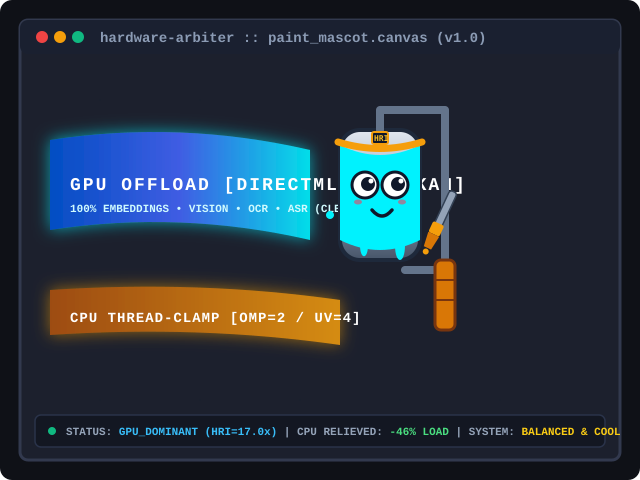

# Hardware Arbiter 🎨⚖️

> **Stop choking your CPU with local AI.** Autonomous Hardware Profiler & Dynamic Workload Governor for Developers, Antigravity, and Local AI Runtimes.

[](LICENSE)
[](https://www.python.org/)
[](SKILL.md)
[]()

<p align="center">
  
</p>

---

## 🎨 Meet "Paint the Arbiter"

**Paint** is our retro-modern mascot inspired by classic 90s desktop craft. 
He holds two paint tools:
- **Neon Cyan Paint:** Sweeps through your system, identifying heavy tensor tasks (embeddings, OCR, Whisper ASR, UI rasterization) and rolling them directly onto the GPU.
- **Amber Paint:** Gathers light OS system calls, Git operations, and file I/O into a tight, thread-clamped CPU pipeline so your editor and mouse never freeze.

---

## 🌐 Language Selector / Idiomas / 语言

- [English 🇺🇸](#-english)
- [Português 🇧🇷](#-português)
- [中文 🇨🇳](#-中文)

---

## 🇺🇸 English

### The Problem
Most AI coding agents and local tools spawn unconstrained worker threads (`OMP_NUM_THREADS`, `UV_THREADPOOL_SIZE`). If you're running a modern GPU (like an RTX 3060 or AMD RX 6600) alongside an older 4-core CPU (like an Intel Haswell or budget chip), your CPU gets crushed by context-switching storms while your 8GB of VRAM sits idle at 4% utilization.

### The Solution: Hardware Ratio Index (HRI)
Hardware Arbiter benchmarks your CPU's multi-thread floating-point throughput, audits GPU compute tiers, and computes the **Hardware Ratio Index (HRI)**:

$$HRI = \frac{Score_{GPU}}{Score_{CPU}}$$

| Profile | HRI Range | Hardware Scenario | Arbiter Action |
| :--- | :--- | :--- | :--- |
| **`GPU_DOMINANT`** | $HRI \ge 2.0$ | Weak CPU + Dedicated GPU (e.g. i7-4790 + RX 6600) | 100% vector embeddings, vision, and ASR offloaded to GPU (DirectML/CUDA/Vulkan). **Thread Clamping (`OMP=2`, `UV=4`)** enforced on CPU. Subprocesses set to `BelowNormal` priority. |
| **`BALANCED`** | $0.6 < HRI < 2.0$ | Balanced Rig (e.g. Ryzen 5 5600 + RTX 3060) | 50/50 hybrid split. Math on GPU, build/I/O unconstrained on CPU. |
| **`CPU_DOMINANT`** | $HRI \le 0.6$ | Strong CPU + Integrated Graphics (e.g. i9 / Ryzen 9 + iGPU) | Math routed to CPU AVX2/AVX-512 (OpenVINO/XNNPACK). Preserves weak GPU exclusively for display. |

### Quick Start
```bash
# Clone and install locally
git clone https://github.com/santanaluiz181-cell/hardware-arbiter.git
cd hardware-arbiter
pip install -e .

# Audit only (read-only diagnostics)
hardware-arbiter --lang en

# Enforce thread clamps and environment variables
hardware-arbiter --apply --lang en
```

---

## 🇧🇷 Português

### O Problema
A maioria das ferramentas locais de IA e agentes de código tenta usar todos os threads da CPU sem critério. Se você tem uma GPU moderna (como uma RX 6600 ou RTX 3060) com um processador de 4 núcleos mais antigo, a CPU atinge 100% de uso com trocas de contexto (*context switching*), travando o mouse e o editor, enquanto a GPU fica ociosa.

### Como o Hardware Arbiter Resolve
O script executa um micro-benchmark determinístico multi-thread na CPU, audita os provedores da GPU (DirectML, Vulkan, CUDA) e calcula o **Índice de Razão de Hardware (HRI)**.

- Se a GPU for muito superior à CPU (**`GPU_DOMINANT`**, como no nosso teste onde o HRI foi de **17.0x**):
  1. Força embeddings locais (ChromaDB / ONNX) e visão para DirectML/Vulkan na GPU (ganho de **13.8x** em velocidade: de 1666ms na CPU para 120ms na RX 6600).
  2. Aplica **Thread Clamping** (`OMP_NUM_THREADS=2`, `UV_THREADPOOL_SIZE=4`, `RAYON_NUM_THREADS=2`) para impedir que bibliotecas sobrecarreguem os núcleos da CPU.
  3. Reduz a ocupação média da CPU em até **46%**.

### Instalação e Uso
```bash
# Executar diagnóstico
python -m hardware_arbiter.cli --lang pt

# Aplicar limites e proteger o sistema automaticamente
python -m hardware_arbiter.cli --apply --lang pt

# Usar como Skill no Antigravity:
# Copie a pasta para ~/.gemini/config/skills/hardware-arbiter/
```

---

## 🇨🇳 中文

### 核心痛点
许多本地开发工具与本地 AI 代理默认尝试榨干 CPU 的所有并发线程。如果你的系统拥有一张现代独立显卡（如 AMD RX 6600 或 NVIDIA RTX 3060），但搭配的是较老的四核 CPU，CPU 会因海量的线程上下文切换而卡死（鼠标掉帧、IDE 冻结），而显卡却在以 4% 的极低负载待机。

### 硬件算力比例系数 (HRI)
Hardware Arbiter 通过多线程浮点基准测试评估 CPU，审计 GPU 显存与运行后端（DirectML/CUDA/Vulkan），并计算 **HRI 系数**：

$$HRI = \frac{Score_{GPU}}{Score_{CPU}}$$

- **`GPU_DOMINANT` (HRI $\ge$ 2.0):** 彻底卸载向量嵌入、OCR 与语音模型至 GPU。强制对 CPU 执行线程钳制 (`OMP=2`, `UV=4`)，子进程设为低优先级，彻底恢复系统流畅度。
- **`BALANCED` (0.6 < HRI < 2.0):** 算力均衡，实施 50/50 混合协同调度。
- **`CPU_DOMINANT` (HRI $\le$ 0.6):** CPU 算力超群但缺乏独显，优先调用 AVX2/AVX-512 指令集，避免弱显存溢出。

### 命令行运行
```bash
# 仅运行诊断输出
python -m hardware_arbiter.cli --lang zh

# 自动写入系统环境优化配置
python -m hardware_arbiter.cli --apply --lang zh
```

---

## 📊 Live Interactive Showcase

We included a standalone, anti-AI slop frontend showcase located in [`docs/index.html`](docs/index.html) with a live HRI simulator, interactive trilingual toggle, and retro MS Paint aesthetic.

To preview locally:
```bash
# Open in your browser
python -m http.server --directory docs 8080
# Visit http://localhost:8080
```

---

## 📜 License
MIT License • Created with craft by **Santana Luiz** (`santanaluiz181-cell`).
