# Hardware Arbiter 🪮⚖️

<p align="center">
  
</p>

> **Passando o Pente Fino no Hardware:** O peso vai com os dentes do pente direto para a GPU; a CPU fica limpa, com os fios assentados e zero travamentos.

[](LICENSE)
[](https://www.python.org/)
[](SKILL.md)
[]()
[](https://santanaluiz181-cell.github.io/hardware-arbiter/)

---

## 🪮🐼 Conheça o "Pandinha Pente Fino" (The Hardware Comb Mascot)

O **Pandinha Pente Fino** é o mascote oficial do Hardware Arbiter. Ele segue o mesmo DNA visual e carisma dos mascotes anteriores do ecossistema: a **Foquinha** (MJ Notch), a **Raposa Kitsune** (Kitsune Router) e o **Elefante Phanty** (Ultimate Research / DESLOP):

- **Anatomia & Animação Viva:**
  - **Chibi Loaf Dapper:** O pandinha veste colete social azul-marinho, contorno sticker com halo protetor e patinhas repousadas.
  - **Expressividade Real:** Respiração orgânica (`3.8s`), piscadas de olho periódicas com duplo brilho anime (`4.8s`), rastreamento de olhar por pupila, fungada de focinho kawaii e orelhas atentas.
  - **Movimento Rítmico do Pente:** Seus bracinhos passam continuamente o pente de âmbar com 8 dentes de precisão (`2.2s ease-in-out`), desembaraçando o fluxo de tensores em tempo real.
- **O Princípio Operacional do Pente:**
  - **Macarrão Emaranhado à Esquerda (CPU Bottleneck):** Os nós caóticos e ondulantes de computação pesada (embeddings do ChromaDB, visão computacional, Whisper ASR) chegam fervendo em fios elétricos neon ciano.
  - **Feixes de Laser Paralelos à Direita (GPU Offload):** Ao passarem pelos dentes do pente de âmbar, os nós se transformam em feixes de laser perfeitamente paralelos e contínuos, descarregados na GPU (DirectML / CUDA / Vulkan).
  - **A Raiz Fica Limpa na CPU:** As rotinas leves de sistema (I/O, Git, terminal) permanecem assentadas na CPU, blindadas por **Thread Clamping (`OMP=2`, `UV=4`)** para o editor e o mouse nunca mais engasgarem.

<p align="center">
  
</p>

---

## 🌐 Seleção de Idioma / Language Selector / 语言导航

- [Português 🇧🇷](#-português)
- [English 🇺🇸](#-english)
- [中文 🇨🇳](#-中文)

---

## 🇧🇷 Português

### A Dor Real de Engenharia
Você coloca uma GPU moderna no computador (como uma AMD RX 6600 ou RTX 3060), mas o seu processador é de 4 núcleos mais antigo (como um Core i7 Haswell de 2014). Quando ferramentas locais de IA ou agentes começam a rodar, bibliotecas como PyTorch ou ONNX tentam instanciar 8 a 16 threads de CPU simultaneamente. 

O resultado: **tempestade de troca de contexto (context-switching storm)**, mouse congelando e editor travado, enquanto a GPU com 8GB de VRAM fica parada com 4% de uso.

### Como o Hardware Arbiter Resolve
O script executa um micro-benchmark determinístico multi-thread, audita a GPU e calcula o **Índice de Razão de Hardware (HRI)**:

$$HRI = \frac{Score_{GPU}}{Score_{CPU}}$$

| Perfil | Faixa de HRI | Cenário de Hardware | Ação do Pente Fino |
| :--- | :--- | :--- | :--- |
| **`GPU_DOMINANT`** | $HRI \ge 2.0$ | CPU fraca/antiga + GPU Dedicada Forte (ex: i7-4790 + RX 6600) | **O pente puxa tudo:** 100% de embeddings vetoriais, visão e transcrição vão para a GPU via DirectML/Vulkan. Na CPU, aplica **Thread Clamping (`OMP=2`, `UV=4`)** e prioridade `BelowNormal` em subprocessos. |
| **`BALANCED`** | $0.6 < HRI < 2.0$ | Máquina equilibrada (ex: Ryzen 5 5600 + RTX 3060) | Divisão 50/50 simétrica. Matemática na GPU, pipelines de compilação e I/O com threads livres na CPU. |
| **`CPU_DOMINANT`** | $HRI \le 0.6$ | CPU potente + GPU integrada/básica (ex: i9 / Ryzen 9 + iGPU) | O pente deixa a matemática na CPU via AVX2/AVX-512, poupando a GPU fraca apenas para renderização de tela. |

### Instalação Rápida
```bash
# Clonar o repositório
git clone https://github.com/santanaluiz181-cell/hardware-arbiter.git
cd hardware-arbiter
pip install -e .

# Apenas diagnosticar o PC (leitura)
hardware-arbiter --lang pt

# Aplicar o pente fino e travar as variáveis no sistema
hardware-arbiter --apply --lang pt
```

---

## 🇺🇸 English

### The Problem
AI tools and coding agents often launch unconstrained worker threads (`OMP_NUM_THREADS`, `UV_THREADPOOL_SIZE`). When paired with an older quad-core CPU and a modern GPU, your CPU gets smothered by context switches while 8GB of high-speed GDDR6 VRAM sits idle.

### The Comb Solution
The **Dapper Comb (Pente Fino)** sweeps through your hardware:
- **Tensors, embeddings, OCR, and speech recognition** get caught in the comb teeth and channeled straight to the GPU.
- **Lightweight OS routines** stay comfortably at the roots on the CPU under strict thread clamping.

### CLI Usage
```bash
# Run trilingual diagnostic
hardware-arbiter --lang en

# Enforce thread clamps & policies
hardware-arbiter --apply --lang en
```

---

## 🇨🇳 中文

### 硬件细齿梳哲学
将系统负载如秀发般精准梳理：
- **重度张量计算**（向量嵌入、OCR视觉、Whisper语音转写）顺着梳齿彻底梳入独立 GPU（DirectML / CUDA / Vulkan）。
- **底层轻量例程**（文件I/O、终端、Git）如同健康发根安稳留驻在 CPU 端，辅以严格的线程钳制 (`OMP=2`, `UV=4`) 杜绝界面冻结。

### 运行方式
```bash
# 诊断当前机器算力比例
hardware-arbiter --lang zh

# 自动将优化配置写入系统环境
hardware-arbiter --apply --lang zh
```

---

## 📊 Live Interactive Showcase (GitHub Pages)

Acesse a demonstração interativa completa em [santanaluiz181-cell.github.io/hardware-arbiter](https://santanaluiz181-cell.github.io/hardware-arbiter/):
- Simulador interativo de HRI com seletor de CPU e GPU.
- Arte vetorial interativa do mascote Pente Fino.
- Design técnico 100% livre de clichês visuais de IA.

---

## 📜 Licença
Distribuído sob licença MIT • Autor: **Santana Luiz** (`santanaluiz181-cell`).
